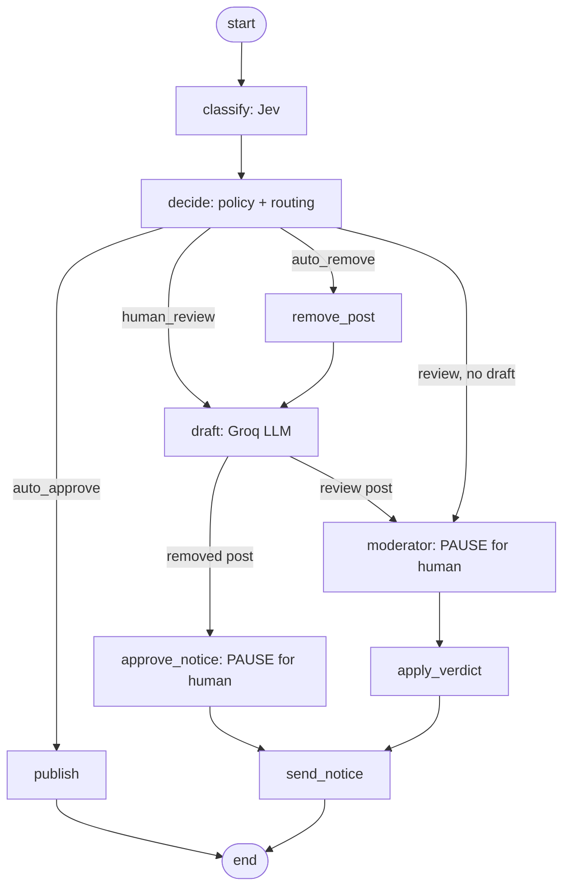

# Level 6: Jev as a Router Node in LangGraph

Levels 1 to 5 built every piece as plain Python functions. Level 6 wires the same
pieces into a **LangGraph workflow**: Jev classifies, the policy routes, an LLM
drafts, and **a human is asked at the right moments**. The graph can pause, be shut
down, and resume later.



## What you will learn

- **State graph**: one shared state dictionary, and nodes that return only what they change
- **Reducers**: why `log` accumulates instead of being overwritten (an audit trail)
- **Conditional edges**: Level 2 and 3's routing becomes an explicit, drawable map
- **Human-in-the-loop with `interrupt()`**: pause, save, resume with the human's answer
- **Checkpoints**: paused posts survive a restart because they are saved in SQLite
- **Where side effects belong**: after the pause, never before it (see below)
- Reusing earlier levels' code unchanged inside nodes

## Where the human steps in

| Post kind | What happens automatically | What a human decides |
|-----------|---------------------------|----------------------|
| Clean | Published | Nothing |
| Clear violation | Removed at once | Whether and how to send the notice |
| Borderline | Nothing yet | Approve or remove the post, plus an optional message |

Nothing is ever sent to an author without a human approving that message.

## Files

| File | Purpose |
|------|---------|
| `state.py` | **New:** the shared state, with a reducer on `log` |
| `graph.py` | **New:** all nodes, routing functions and the wiring |
| `outbox.py` | **New:** a stand-in for "send the message" (appends to a JSONL file) |
| `main.py` | **New:** the commands `graph`, `run`, `status`, `review` |
| `test_graph.py` | **New:** 28 offline checks of every path through the graph |
| `config.py`, `questions.py`, `policy.py` | Copied from Level 5 |
| `routing.py`, `prompts.py`, `drafter.py` | Copied from Level 5 |
| `posts.csv` | The same 60 posts |

## Setup

Two new packages, so install again from the repository root:

```powershell
pip install -r requirements.txt
```

## Run

```powershell
python level-6-langgraph-router\test_graph.py
python level-6-langgraph-router\main.py graph
python level-6-langgraph-router\main.py run --every 5 --fresh
python level-6-langgraph-router\main.py status
python level-6-langgraph-router\main.py review
```

`run` and `review` are separate processes on purpose. Run, close the terminal, come
back tomorrow and review. The posts are saved in `output\checkpoints.sqlite`.

| Command | What it does |
|---------|--------------|
| `graph` | Prints the workflow as a Mermaid diagram (paste it into https://mermaid.live) |
| `run [--every N] [--limit N] [--no-llm] [--fresh]` | Sends posts through the graph. It pauses where a human is needed. Posts already started are skipped |
| `status` | Shows who is waiting and who finished, and writes `output\report.csv` |
| `review` | Walks you through each waiting post and resumes the graph with your answer |

Start with `--every 5` (12 posts). `posts.csv` is ordered: the first 16 posts are
all clean, so a plain `--limit 10` never pauses. `--every 5` samples across clean,
violating and borderline posts. Each post costs one Jev call, and posts that need a
message cost one Groq call. `--no-llm` skips drafting.

In `review`, the keys are shown in the prompt. For a borderline post you choose
`a` (approve) or `r` (remove), then `y` to send the draft, `e` to edit it, or `n` to
send nothing. Approved messages land in `output\outbox.jsonl`.

## The rule that surprises people

When a paused node resumes, **it runs again from its first line**. Only the code
*after* `interrupt()` continues. So:

- The two pause nodes (`approve_notice`, `moderator`) contain nothing but the
  `interrupt()` call and reading its answer.
- Sending the message is its own node, `send_notice`, which runs exactly once.

If you put "send an email" before `interrupt()`, the email goes out twice. The test
`resuming did not send the message twice` guards this.

## Experiments

1. Run `main.py graph` and look at the diagram. Which edges are conditional (dashed)?
2. Run `--every 5`, run it again, and see "skipping" for every started post.
3. Press `s` (skip) in `review`, then run `review` again. The post is still waiting.
4. Open `output\report.csv` and read the `log` column: the graph's audit trail.
5. Run `--no-llm` and notice that removals finish without any pause.
6. Add a node (say, one that tags off-topic posts) and a conditional edge to it.
7. Change the `moderator` node so it also accepts `decision="escalate"`.

## Limits of this design

- The CLI processes posts one at a time. To combine this with Level 5's concurrency,
  call the compiled graph with `abatch()` and async nodes.
- SQLite checkpoints suit one machine. A team of moderators would use a shared
  database checkpointer and a web UI that calls `Command(resume=...)`.
- `review` does not time out. A real queue would escalate posts nobody answers.